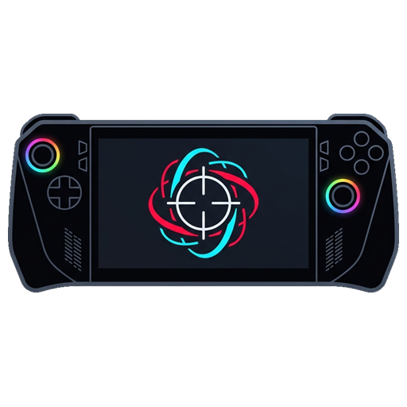
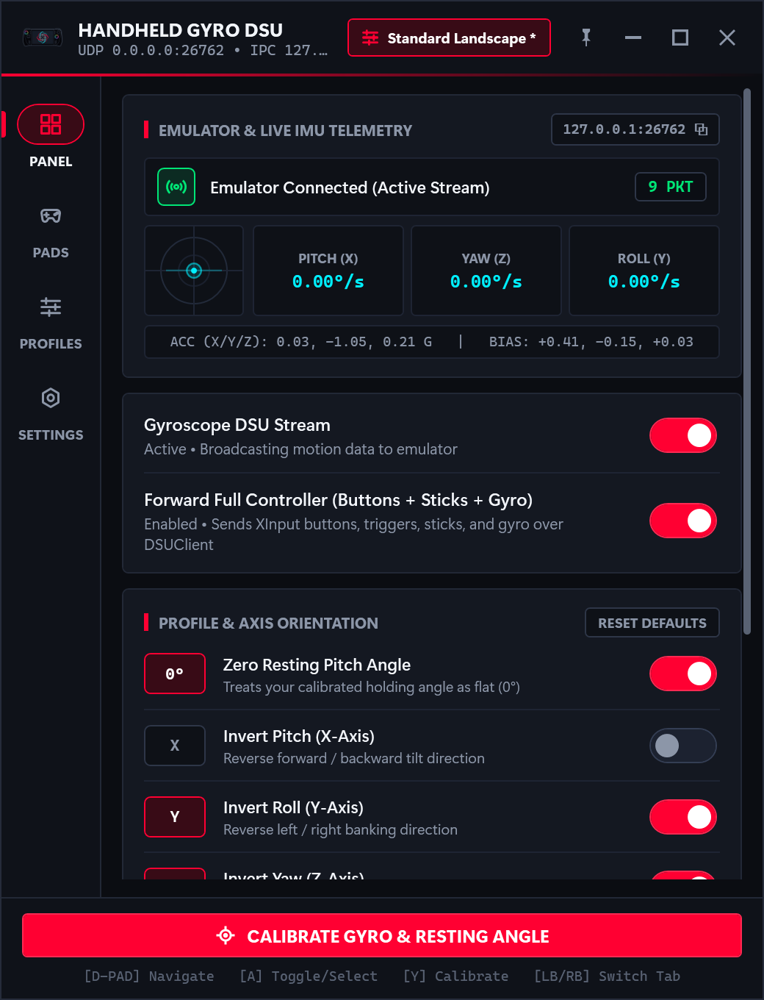
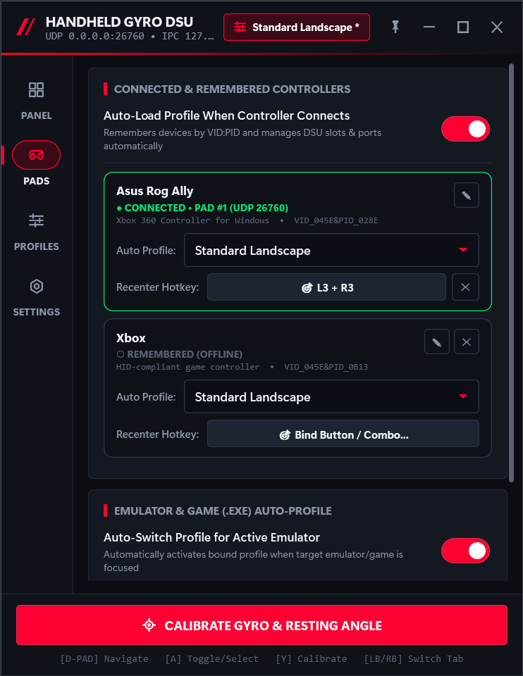
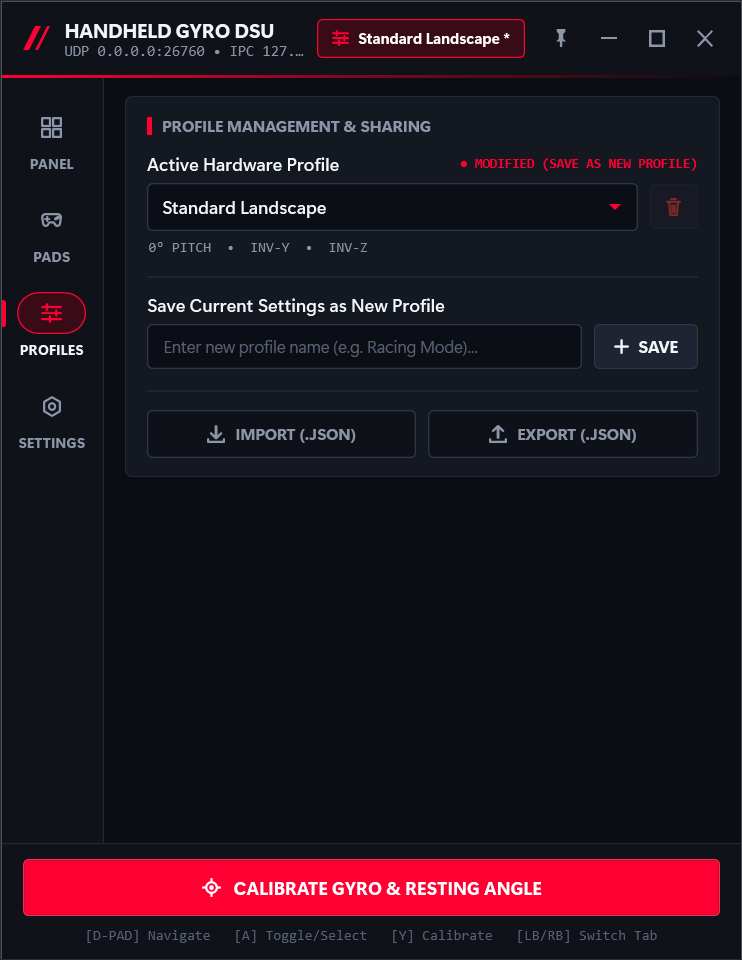
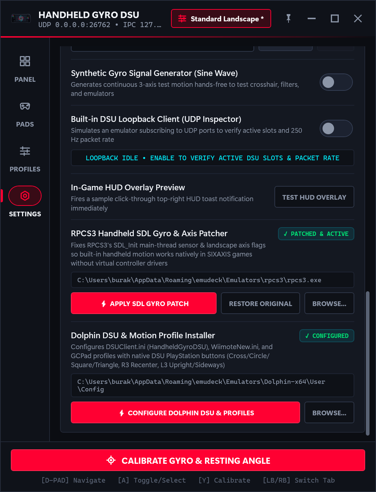
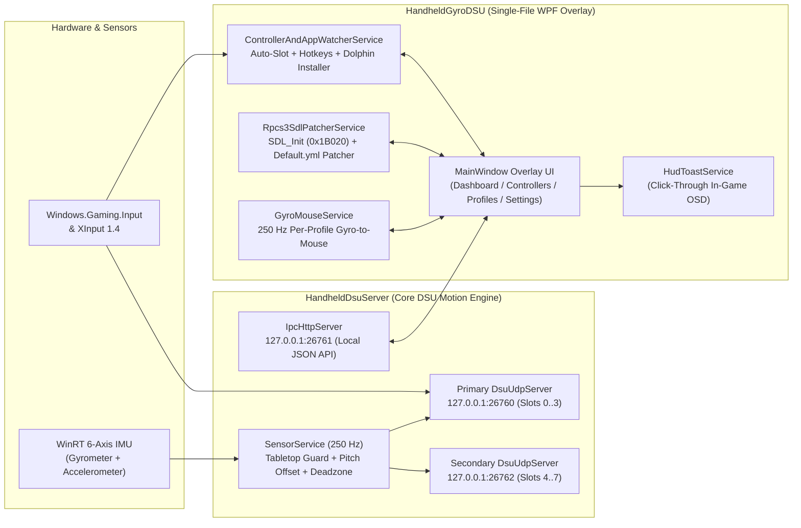

<p align="center">
  
</p>

<h1 align="center">HandheldGyroDSU</h1>

<p align="center">
  <strong>Native Gyro & Motion Controls for Emulators on Windows Handhelds — Without Controller Driver Conflicts</strong>
</p>

[](https://github.com/brktlhylmz/HandheldGyroDSU/actions/workflows/build-and-release.yml)
[](https://github.com/brktlhylmz/HandheldGyroDSU/releases/latest/download/HandheldGyroDSU-win-x64.zip)
[](https://github.com/brktlhylmz/HandheldGyroDSU/releases/latest/download/HandheldGyroDSU.exe)
[](https://github.com/brktlhylmz/HandheldGyroDSU/releases/latest/download/HandheldGyroDSU-Standalone.exe)
[](https://github.com/brktlhylmz/HandheldGyroDSU/releases)
[](https://dotnet.microsoft.com/)
[](https://v1993.github.io/cemuhook-protocol/)
[](LICENSE)

**HandheldGyroDSU** is a lightweight, zero-configuration **Cemuhook DSU (`v1001`) motion server**, **emulator configurator**, and **desktop / in-game HUD companion** built to bring native gyro aiming and motion controls to **Dolphin**, **RPCS3**, **Cemu**, **Nintendo Switch emulators** (**Eden**, **Yuzu**, **Sudachi**, **Citron**, **Ryujinx**), and **PC / Steam games** on Windows handheld gaming PCs (**ASUS ROG Ally / Ally X**, **Lenovo Legion Go**, **MSI Claw**, **Ayaneo**, **GPD**) and motion-capable controllers.

### Why HandheldGyroDSU?
On Windows handhelds, trying to use gyro in emulators often means fighting between **ASUS Armoury Crate**, **Steam Input**, and **Handheld Companion**—resulting in virtual controller conflicts, `HidHide` issues, double inputs, or broken desktop/gamepad mode switching. **HandheldGyroDSU** solves this by reading your handheld's built-in Windows `Gyrometer` and `Accelerometer` directly and streaming native Cemuhook DSU motion data to your emulators **without installing virtual gamepad drivers or hijacking your controls**.

It bridges internal Windows WinRT Inertial Measurement Units (`Gyrometer` + `Accelerometer`) and connected gamepads directly to **Dolphin**, **RPCS3**, **Cemu**, **Eden**, **Yuzu**, **Sudachi**, **Ryujinx**, and **PC games** with sub-4ms latency—available as both a **lightweight Portable `.zip` archive** and a **Self-Contained Single-File `.exe`**.

> [!NOTE]
> **Active Development & Continuous Release (`master`):** This repository uses a rolling release workflow. Every push to the `master` branch automatically runs the Cemuhook DSU `v1001` protocol self-test suite on GitHub Actions and publishes a fresh **`v1.0.<build>`** release with updated `.zip` and `.exe` binaries.

---

## 📥 Downloads (Auto-Published from `master`)

Every commit pushed to `master` is automatically built and published to [GitHub Releases](https://github.com/brktlhylmz/HandheldGyroDSU/releases). The links below always point to the newest verified build:

| Package | Size | Format | Description | Direct Download |
| :--- | :---: | :--- | :--- | :--- |
| **`HandheldGyroDSU-win-x64.zip`** | **~500 KB** | **Portable `.ZIP` Archive** *(Recommended)* | Full transparent folder structure (`HandheldGyroDSU.exe`, `Locales/*.json`, `README.md`, `LICENSE`, `install.ps1`). Requires [.NET 10 Desktop Runtime](https://dotnet.microsoft.com/download/dotnet/10.0). | **[⬇️ Download `.ZIP`](https://github.com/brktlhylmz/HandheldGyroDSU/releases/latest/download/HandheldGyroDSU-win-x64.zip)** |
| **`HandheldGyroDSU.exe`** | **~500 KB** | **Lightweight Single-File `.EXE`** | Compact single-file executable (bundles app, server & locales into 1 file; uses system [.NET 10 Desktop Runtime](https://dotnet.microsoft.com/download/dotnet/10.0)). | **[⬇️ Download Lightweight `.EXE`](https://github.com/brktlhylmz/HandheldGyroDSU/releases/latest/download/HandheldGyroDSU.exe)** |
| **`HandheldGyroDSU-Standalone.exe`** | **~68 MB** | **Self-Contained Single-File `.EXE`** | Includes the entire Microsoft `.NET 10` & WPF runtime embedded inside the executable — runs on any Windows 10/11 PC with zero prerequisites. | **[⬇️ Download Standalone `.EXE`](https://github.com/brktlhylmz/HandheldGyroDSU/releases/latest/download/HandheldGyroDSU-Standalone.exe)** |
| **`SHA256SUMS.txt`** | **1 KB** | **SHA-256 Checksums** | Cryptographic SHA-256 hashes for verifying the downloaded `.zip` and `.exe` files. | **[🔒 View `SHA256SUMS.txt`](https://github.com/brktlhylmz/HandheldGyroDSU/releases/latest/download/SHA256SUMS.txt)** |

---

## 🎬 Live Gameplay Demos (ASUS ROG Ally)

### 1. Cemu — *Splatoon* (Gyro Aiming + Real-Time Telemetry)
> *Live gyro aiming in **Cemu (Splatoon)** alongside **HandheldGyroDSU** real-time telemetry:*

https://github.com/user-attachments/assets/6d894e63-4da2-45ef-b621-844247db87f9

*🎥 Video file in repository: [docs/demo/cemu-splatoon-demo.mp4](docs/demo/cemu-splatoon-demo.mp4)*

### 2. Dolphin — *Mario Kart Wii* (Wii Wheel Sideways Tilt Steering)
> *Native Wii Wheel tilt steering & motion controls in **Dolphin (Mario Kart Wii)** using the `HandheldGyroDSU_Sideways` profile:*

*🎥 **[▶️ Watch / Download Mario Kart Wii Gameplay Demo (`docs/demo/dolphin-mario-kart-wii-demo.mp4`)](docs/demo/dolphin-mario-kart-wii-demo.mp4)***

### 3. Dolphin — *Super Mario Galaxy 2* (Star Pointer `IMUIR` & 6-Axis Motion)
> *Native Wii Remote `IMUIR` Star Pointer aiming, Spin Attack, and motion controls in **Dolphin (Super Mario Galaxy 2)** using the `HandheldGyroDSU_Xbox` profile:*

*🎥 **[▶️ Watch / Download Super Mario Galaxy 2 Gameplay Demo (`docs/demo/dolphin-super-mario-galaxy-2-demo.mp4`)](docs/demo/dolphin-super-mario-galaxy-2-demo.mp4)***

---

## 📚 Documentation & Guides

- 📘 **[Complete Emulator Setup Guide (`docs/EMULATOR_SETUP.md`)](docs/EMULATOR_SETUP.md)** — Step-by-step instructions for **Dolphin** (One-Click Installer & *Super Mario Galaxy* controls), **RPCS3** (Handheld SDL Gyro Patcher), **Cemu**, **Eden / Yuzu / Sudachi**, **Ryujinx**, and **PC / Steam Games** (Gyro-to-Mouse).
- 🛠️ **[Troubleshooting & FAQ (`docs/TROUBLESHOOTING.md`)](docs/TROUBLESHOOTING.md)** — Fixing Armoury Crate / Steam Input conflicts, *Super Mario Galaxy* Upright (`L3`) vs Pointer (`R3`) modes, EmuDeck Dolphin paths, and Tabletop Calibration Guard.

---

## 📸 Screenshots

| **Dashboard (Live Gyro Telemetry & Radar)** | **Controllers (Custom Names, Hotkeys & Auto-Switch)** |
| :---: | :---: |
|  |  |
| **Profiles (Per-Profile Gyro-to-Mouse & Presets)** | **Settings (Dolphin & RPCS3 One-Click Configurators)** |
|  |  |

---

## ✨ Key Features

- **🚫 Zero Controller Conflicts & Direct IMU Streaming**:
  - Polls hardware `Windows.Devices.Sensors.Gyrometer` and `Accelerometer` at a 4 ms interval (`250 Hz`) with stack-allocated `Span<byte>` Cemuhook DSU `v1001` UDP packet serialization and IEEE 802.3 CRC32 verification.
  - **Full Gamepad Input Forwarding (Enabled by Default)**: Embeds live XInput buttons (`Cross`, `Circle`, `Square`, `Triangle`, `L1`, `R1`, `Share`, `Options`, `L3`, `R3`), D-Pad, dual analog sticks, and analog triggers (`L2`/`R2`) directly into the DSU packet stream alongside motion data so emulators can bind `DSUClient/0/HandheldGyroDSU` as a single unified controller.
- **🐬 One-Click Dolphin DSU & Motion Profile Installer (`Settings`)**:
  - Auto-detects standard (`%AppData%\Dolphin Emulator\Config`), Documents, and **EmuDeck** Dolphin installations—or lets you pick any portable `Dolphin.exe` via **`BROWSE...`**.
  - Configures `DSUClient.ini` (`[Server] Entries = HandheldGyroDSU:127.0.0.1:26760;`), sets `Device = DSUClient/0/HandheldGyroDSU` in `WiimoteNew.ini` and `GCPadNew.ini`, maps native DSU PlayStation button names (`Cross`/`Circle`/`Square`/`Triangle`), binds **`R3`** to `IMUIR/Recenter`, and binds **`L3`** to `Hotkeys/Upright Toggle` (for *Super Mario Galaxy* Star Ball & Manta Ray surfing).
  - Automatically prompts to enable **Forward Full Controller (Buttons + Sticks + Gyro)** if it is currently turned off when installing Dolphin profiles.
- **🎮 One-Click RPCS3 Handheld SDL Gyro & Axis Patcher (`Settings`)**:
  - Solves why built-in handheld motion fails in RPCS3's `SDL` pad handler: dynamically patches `rpcs3.exe`'s main-thread `SDL_Init` flags from `0x00013000` to **`0x0001B020`**—adding both `SDL_INIT_SENSOR (0x8000)` (so WinRT sensors fire on the main STA thread) and `SDL_INIT_VIDEO (0x20)` (so SDL3 rotates portrait handheld panels into proper landscape SIXAXIS axes).
  - Creates an automatic backup (`rpcs3.exe.bak`) with one-click **`RESTORE ORIGINAL`** support, and configures `config/input_configs/global/Default.yml` to use `Handler: SDL` (`Device: XInput Controller 1`).
- **🖱️ Per-Profile Gyro-to-Mouse for PC & Steam Games (`Profiles`)**:
  - Translates 250 Hz gyro motion into relative mouse input (`SendInput`) per profile with **Hold Button (ADS)**, **Toggle Button**, or **Always On** activation modes, and automatically pauses cursor injection whenever the HandheldGyroDSU window is focused.
- **🎯 Per-Controller Quick Recenter Hotkey (Single, Combo & Handheld Macro Keys)**:
  - Assign a custom recenter shortcut per controller directly in the **Controllers** tab—supports single buttons (`R3`, `Select`), 2-button combinations (`Select + R3`, `LB + RB`), extra `RawGameController` buttons (`RawBtn`), or handheld back-paddle macro keys (`M1`/`M2` mapped to `F6..F24`, `Insert`, `Home`, etc.).
  - Re-centers pitch/roll posture and gyro bias instantaneously in-game (`POST /recenter`) with click-through HUD confirmation.
- **🛡️ Tabletop (Stationary) Calibration Guard**:
  - Prevents accidental mid-air or tilted hand calibrations from corrupting zero-rate gyro bias offsets (`±1.5°/s` clamp + `AccZ ≤ -0.82G` flat-surface check). Enabled by default and toggleable in **Settings**.
- **🎮 Custom Controller Naming & Multi-Controller Identification (Up to 8 Pads)**:
  - Automatically assigns slots `0..3` on primary UDP port **`26760`** and spawns a **Secondary DSU Cluster** on UDP port **`26762`** for controllers 5–8.
  - Automatically numbers identical controllers (`#2`, `#3`), highlights the currently pressed controller with a live **`ACTIVE INPUT`** badge, and lets you assign custom names (`✎`) to each controller.
- **🪟 Click-Through In-Game HUD & Always-on-Top Pin (`📌`)**:
  - Pin (`📌`) the window above other apps when tuning settings, or minimize to the system tray (`—` / `✕`).
  - Uses a click-through `WS_EX_TRANSPARENT | WS_EX_NOACTIVATE` HUD toast overlay so fullscreen games never lose focus, and drops UI polling to **0% CPU** when minimized to the system tray.
- **🕹️ 100% Gamepad-First UI & Multi-Language Support (`en` / `tr`)**:
  - Full controller navigation (`LB`/`RB` tabs, `D-Pad`/`Left Stick` focus & sliders, `A` toggle, `Y` calibrate) and embedded JSON localization (`English` & `Türkçe`) with instant live switching.

---

## 🧪 Emulator Compatibility & Current Testing Status

| Emulator | System | Status | Tested Games | Setup Mode |
| :--- | :--- | :---: | :--- | :--- |
| **Eden** (`eden.exe`) | Nintendo Switch | ✅ **Tested** | *Splatoon 2* | `CemuhookUDP` (`127.0.0.1:26760` + `26762` for Pads 5–8) |
| **Cemu** (`cemu.exe`) | Wii U | ✅ **Tested** | *Splatoon* | `DSUController` (`127.0.0.1:26760`) |
| **Dolphin** (`dolphin.exe`) | Wii / GameCube | ✅ **Tested** | *Super Mario Galaxy 1 & 2*, *Mario Kart Wii* | **One-Click Installer** (`DSUClient/0/HandheldGyroDSU`, `R3` Recenter, `L3` Upright Toggle) |
| **RPCS3** (`rpcs3.exe`) | PlayStation 3 | ✅ **Tested** | *SIXAXIS Motion Titles* | **One-Click SDL Gyro Patcher** (`Settings` tab) |
| **Yuzu / Sudachi / Citron** | Nintendo Switch | ⚪ *Untested (Protocol Compatible)* | *Community testing welcome* | `CemuhookUDP` (`127.0.0.1:26760`) |
| **Ryujinx** (`ryujinx.exe`) | Nintendo Switch | ⚪ *Untested (Protocol Compatible)* | *Community testing welcome* | Native CemuHook Motion (`127.0.0.1:26760`, Slot `0..3`) |

> 💬 **Tested another game, emulator, or handheld?** Open an issue or pull request to help expand the verified compatibility table!

### Supported Hardware & Operating Systems

| Category | Device / Platform | Status | Motion & Input Source |
| :--- | :--- | :---: | :--- |
| **Operating Systems** | **Windows 11 (`22H2` / `23H2` / `24H2` x64)**, **Windows 10 (`19041+` x64)** | ✅ **Tested** | WinRT `Windows.Devices.Sensors`, `Windows.Gaming.Input`, `XInput 1.4` |
| **ASUS ROG Ally** | **ASUS ROG Ally / ROG Ally X** | ✅ **Tested** | Internal 6-Axis IMU (`Gyrometer` + `Accelerometer`) + Built-in XInput Gamepad |
| **Other Windows Handhelds** | **Lenovo Legion Go / Go S**, **MSI Claw**, **Ayaneo**, **GPD Win 4 / Mini / Max 2**, **OneXPlayer** | ⚪ *Untested (WinRT IMU Compatible)* | Internal 6-Axis WinRT IMU (`Gyrometer` + `Accelerometer`) + Built-in Gamepad |
| **PlayStation Controllers** | **Sony DualSense (`054C:0CE6`)**, **DualSense Edge (`054C:0DF2`)**, **DualShock 4 v1/v2 (`054C:05C4`, `054C:09CC`)** | ⚪ *Untested (`VID:PID` Preset Ready)* | Auto-Detected via `VID:PID` + `DualSense / DS4` Preset |
| **Nintendo Controllers** | **Switch Pro Controller (`057E:2009`)**, **Joy-Con L/R (`057E:2006`, `057E:2007`)** | ⚪ *Untested (`VID:PID` Preset Ready)* | Auto-Detected via `VID:PID` + `Switch Pro` Preset |
| **Third-Party Motion Pads** | **8BitDo Ultimate / Pro 2 (`2DC8:*`)**, **GameSir (`3537:*`)**, **Flydigi Vader / Apex** | ⚪ *Untested (`VID:PID` Preset Ready)* | Auto-Detected via `Windows.Gaming.Input.RawGameController` |

---

## 🚀 Quick Start & Emulator Setup

### 1. Run `HandheldGyroDSU.exe`
Download and launch [**`HandheldGyroDSU.exe`**](https://github.com/brktlhylmz/HandheldGyroDSU/releases/latest/download/HandheldGyroDSU.exe). The server immediately starts broadcasting Cemuhook DSU `v1001` packets on **`127.0.0.1:26760`**.

### 2. Connect Your Emulator *(Full Guide: [docs/EMULATOR_SETUP.md](docs/EMULATOR_SETUP.md))*

#### **Dolphin (Wii / GameCube) — One-Click Installer (`Settings` Tab)**
1. Open **HandheldGyroDSU → Settings → Dolphin DSU & Motion Profile Installer**.
2. Click **`CONFIGURE DOLPHIN DSU & PROFILES`** (or click **`BROWSE...`** to select your `Dolphin.exe` if you use EmuDeck or a custom portable folder).
3. HandheldGyroDSU configures `DSUClient.ini` (`[Server] Entries = HandheldGyroDSU:127.0.0.1:26760;`), sets `Device = DSUClient/0/HandheldGyroDSU`, and installs ready-to-use profiles:
   - **Standard Wii Remote + Nunchuk + IR Pointer (`HandheldGyroDSU_Xbox`)**: Applied automatically to `WiimoteNew.ini`. Press **`R3` (Right Stick Click)** to recenter the pointer (`IMUIR/Recenter`), **`L3` (Left Stick Click)** to toggle **Upright Wii Remote** mode (*Super Mario Galaxy* Star Ball & Manta Ray surfing), and **`LB` (`L1`)** to Shake/Spin.
   - **Mario Kart Wii / Sideways Wii Wheel (`HandheldGyroDSU_Sideways`)**: Load in Dolphin's Emulated Wii Remote profile dropdown.
   - **GameCube Controller (`HandheldGyroDSU_Xbox`)**: Applied automatically to `GCPadNew.ini`.

#### **RPCS3 (PlayStation 3) — One-Click SDL Gyro & Axis Patcher (`Settings` Tab)**
1. Open **HandheldGyroDSU → Settings → RPCS3 Handheld SDL Gyro & Axis Patcher**.
2. Select your `rpcs3.exe` via **`BROWSE...`** (if not auto-detected) and click **`APPLY SDL GYRO PATCH`**.
3. HandheldGyroDSU backs up `rpcs3.exe.bak`, patches `SDL_Init` (`0x00013000` → `0x0001B020`) so `SDL_INIT_SENSOR | SDL_INIT_VIDEO` run on the main thread with landscape display orientation, and sets Player 1 in `config/input_configs/global/Default.yml` to **`Handler: SDL`** (`Device: XInput Controller 1`). *(Click **`RESTORE ORIGINAL`** anytime to revert).*

#### **Cemu (Wii U)**
1. Open **Options → Input settings**.
2. Set **Emulated controller** to `Wii U GamePad` (or `Wii U Pro Controller`).
3. Click **`+` (Add)** under **Controller** → select **DSUController** (`127.0.0.1`, port `26760`) and check **Use motion**.

#### **Eden / Yuzu / Sudachi (Nintendo Switch)**
1. Open **Emulation → Configure → Controls**.
2. Click **Configure** next to **Motion** → enable **CemuhookUDP** (`127.0.0.1`, port `26760`) and click **Test**.
3. Click the **Motion** button on the controller view and shake your device to bind `[cemuhookudp]`.

#### **Ryujinx (Nintendo Switch)**
1. Open **Options → Settings → Input → Player 1 Configure**.
2. Enable **Enable Motion Controls** and **Use CemuHook compatible motion** (`127.0.0.1:26760`, Slot `0`).

---

## 🏗️ Architecture Overview



### Repository Structure

```text
HandheldGyroDSU/
├── HandheldGyroDSU.sln                 # .NET 10 Solution (Core Server + Single-File WPF Overlay)
├── HandheldDsuServer.csproj            # Core DSU UDP Server & CLI Self-Test Engine
├── Program.cs                          # Headless CLI EntryPoint & Automated --self-test Suite
├── Models/                             # AppSettings, AutomationConfig, DeviceProfile, HandheldProfile, MotionData
├── Protocol/                           # Cemuhook DSU v1001 Packet Builder & IEEE 802.3 CRC32
├── Services/                           # SensorService, DsuUdpServer, IpcHttpServer, ProfileManager, StartupManager
├── HandheldDsuWidget/                  # WPF Desktop & In-Game HUD Companion (HandheldGyroDSU.exe)
│   ├── MainWindow.xaml                 # Responsive Card Layout & Left Navigation Rail
│   ├── MainWindow.*.cs                 # Modular Partial Classes (Dashboard, Controllers, Profiles, Settings, Tray)
│   ├── Services/                       # ControllerAndAppWatcherService, Rpcs3SdlPatcherService, GyroMouseService, UpdateService, DsuIpcClient, LocalizationService, HudToastService
│   └── Locales/                        # Embedded & Extensible JSON Dictionaries (en.json, tr.json)
├── docs/                               # Documentation & Screenshots (EMULATOR_SETUP.md, TROUBLESHOOTING.md)
└── .github/workflows/                  # Automated Build, DSU Protocol Self-Test & Single-File .EXE Release CI
```

---

## 🛠️ Building from Source

### Prerequisites
- **Windows 10 (Build 19041+)** or **Windows 11 (x64)**
- **[.NET 10.0 SDK](https://dotnet.microsoft.com/download/dotnet/10.0)**

### Build, Self-Test & Publish Standalone `.exe`
```powershell
# 1. Clone the repository
git clone https://github.com/brktlhylmz/HandheldGyroDSU.git
cd HandheldGyroDSU

# 2. Build the solution (0 Warnings, 0 Errors)
dotnet build .\HandheldGyroDSU.sln -c Release

# 3. Run the automated Cemuhook DSU v1001 & IPC self-test suite
dotnet run --project .\HandheldDsuServer.csproj -c Release -- --self-test

# 4. Publish a standalone single-file HandheldGyroDSU.exe
dotnet publish .\HandheldDsuWidget\HandheldDsuWidget.csproj -c Release -r win-x64 --self-contained true -p:PublishSingleFile=true -p:IncludeNativeLibrariesForSelfExtract=true -p:EnableCompressionInSingleFile=true -o .\publish
```

---

## 🤝 Contributing

Contributions, controller `VID:PID` additions, and new language translations (`HandheldDsuWidget/Locales/*.json`) are welcome! Please read [CONTRIBUTING.md](CONTRIBUTING.md) and [AGENTS.md](AGENTS.md) before submitting a pull request.

## 📄 License

Distributed under the **MIT License**. See [LICENSE](LICENSE) for full details.
