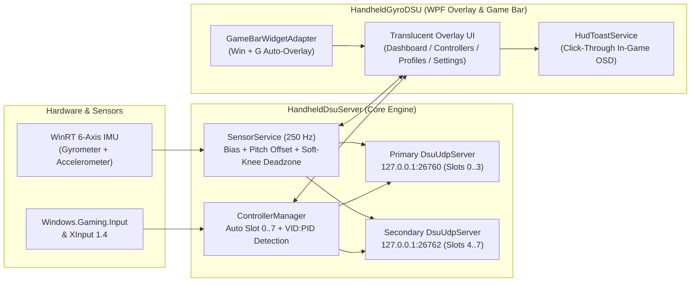

# HandheldGyroDSU

[](https://dotnet.microsoft.com/)
[](https://v1993.github.io/cemuhook-protocol/)
[-0078D6?logo=windows)](https://www.microsoft.com/windows)
[](LICENSE)

**HandheldGyroDSU** is a zero-configuration **250 Hz Cemuhook DSU (`v1001`) motion server** and **Xbox Game Bar (`Win + G`) companion overlay** designed for Windows handheld gaming PCs (**ASUS ROG Ally / Ally X**, **Lenovo Legion Go**, **MSI Claw**, **Ayaneo**, **GPD**) and external motion-capable controllers (**Sony DualSense**, **DualShock 4**, **Nintendo Switch Pro**, **8BitDo**, **GameSir**).

It bridges internal Windows WinRT Inertial Measurement Units (`Gyrometer` + `Accelerometer`) and connected controllers directly to emulators such as **Cemu**, **Eden**, **Yuzu**, **Sudachi**, **Ryujinx**, and **Dolphin** with sub-4ms latency—without requiring bloated vendor background suites.

---

## ✨ Key Features

- **⚡ 250 Hz Low-Latency IMU Engine**: Reads hardware `Windows.Devices.Sensors.Gyrometer` and `Accelerometer` at a 4 ms report interval (`250 Hz`) with zero-allocation `Span<byte>` UDP packet serialization and IEEE 802.3 CRC32 verification.
- **🎯 Per-Profile Sensitivity & Soft-Knee Jitter Deadzone**:
  - **Gyro Sensitivity (`0.2x – 3.0x`)**: Boost aim responsiveness for bow aiming or dial it down for precision puzzles.
  - **Soft-Knee Jitter Deadzone (`0.0°/s – 3.0°/s`)**: Filters out handheld fan vibrations and resting hand micro-tremors (`sign(v) * (|v| - dz)`) without introducing a sudden step jump when crossing the threshold.
- **🎮 Zero-Config Multi-Controller DSU (Up to 8 Controllers)**:
  - Automatically assigns up to 4 controllers to DSU slots `0..3` on primary UDP port **`26760`**.
  - When a 5th–8th controller is connected, automatically spawns a **Secondary DSU Cluster** on UDP port **`26762`** (slots `0..3`)—enabling full 8-player local multiplayer in Switch/Wii U emulators with zero manual slot configuration.
- **🔄 Context-Aware Auto-Profile Switching**:
  - Automatically detects connected USB/Bluetooth controller `VID:PID` signatures and foreground game/emulator `.exe` processes (`cemu.exe`, `eden.exe`, `yuzu.exe`, `ryujinx.exe`, `dolphin.exe`) to switch axis orientation, sensitivity, and deadzone on the fly.
- **🪟 `Win + G` Xbox Game Bar Companion & Click-Through HUD**:
  - Pops up automatically alongside **Xbox Game Bar (`Win + G`)** so you can recalibrate or tweak gyro sensitivity mid-game, and hides automatically when returning to the game unless pinned (`📌`).
  - Features a **Click-Through In-Game HUD Toast (`WS_EX_TRANSPARENT | WS_EX_NOACTIVATE`)** that notifies you of calibration and profile switches without ever stealing fullscreen focus.
  - Drops UI polling when minimized to the system tray for **0% background UI CPU usage**.
- **🕹️ 100% Gamepad-First Navigation**:
  - Every tab and control works seamlessly with a controller: `LB` / `RB` to switch Navigation Rail tabs, `D-Pad` / `Left Stick` to navigate and adjust sliders, `A` to toggle, and `Y` for instant 1-second stationary bias & pitch offset calibration.
- **🛡️ Modern Standby (`S0 Low Power Idle`) Watchdog**:
  - Automatically hooks `WM_POWERBROADCAST` (`PBT_APMRESUMEAUTOMATIC`) and monitors WinRT sensor health to rebind hung I2C/BOSCH IMU drivers after handheld sleep/hibernate cycles.
- **🌍 Multi-Language UI (`en` / `tr`)**:
  - 100% JSON-driven localization (`HandheldDsuWidget/Locales/en.json` & `tr.json`) with instant live language switching.

---

## 🖥️ Supported Hardware

| Category | Supported Devices | Motion Source |
| :--- | :--- | :--- |
| **Windows Handhelds** | **ASUS ROG Ally / ROG Ally X**, **Lenovo Legion Go / Go S**, **MSI Claw**, **Ayaneo**, **GPD Win 4 / Mini / Max**, **OneXPlayer** | Internal 6-Axis IMU (`Windows.Devices.Sensors`) + Built-in XInput Gamepad |
| **PlayStation Controllers** | **Sony DualSense (`054C:0CE6`)**, **DualSense Edge (`054C:0DF2`)**, **DualShock 4 v1/v2 (`054C:05C4`, `054C:09CC`)** | Native Motion Capability Detection + Auto Profile (`DualSense / DS4`) |
| **Nintendo Controllers** | **Switch Pro Controller (`057E:2009`)**, **Joy-Con L/R (`057E:2006`, `057E:2007`)** | Native Motion Capability Detection + Auto Profile (`Switch Pro`) |
| **Third-Party Motion Pads** | **8BitDo Ultimate / Pro 2 (`2DC8:*`)**, **GameSir (`3537:*`)**, **Flydigi Vader / Apex** | Auto-Detected via `Windows.Gaming.Input.RawGameController` |
| **Standard XInput Pads** | **Xbox Wireless Controller (`045E:*`)** and compatible XInput controllers | Paired with Handheld IMU or Virtual Motion Routing |

---

## 🚀 Quick Start & Emulator Setup

### 1. Launch HandheldGyroDSU
Run `HandheldGyroDSU.exe`. The server immediately starts broadcasting Cemuhook DSU `v1001` motion packets on **`127.0.0.1:26760`** (click the endpoint badge on the **Dashboard** tab to copy `127.0.0.1:26760` to your clipboard).

### 2. Configure Your Emulator

#### **Cemu (Wii U)**
1. Open **Options → Input settings**.
2. Set **Emulated controller** to `Wii U GamePad` (or `Wii U Pro Controller`).
3. Click **`+` (Add)** under **Controller** → select **DSUController** as the API.
4. Confirm Server IP is `127.0.0.1` and Port is `26760`, then enable **Use motion**.

#### **Eden / Yuzu / Sudachi (Nintendo Switch)**
1. Open **Emulation → Configure → Controls**.
2. Click **Configure** next to **Input Navigation / Motion** (bottom left) → enable **CemuhookUDP** (`127.0.0.1`, port `26760`) and click **Test**.
3. Shake your handheld or click the **Motion** button in the controller mapping screen to bind `[cemuhookudp]` to Player 1.
4. *(5–8 Player Local Multiplayer)*: Add a second server entry in CemuhookUDP with `127.0.0.1` and port **`26762`**.

#### **Ryujinx (Nintendo Switch)**
1. Open **Options → Settings → Input → Player 1 Configure**.
2. Enable **Enable Motion Controls** and **Use CemuHook compatible motion**.
3. Set **Server Host** to `127.0.0.1:26760` and **Controller Slot** to `0`.

#### **Dolphin (Wii / GameCube)**
1. Open **Controllers → Alternate Input Sources (DSU Client)**.
2. Check **Enable** and add `127.0.0.1` port `26760`.
3. Under **Emulated Wii Remote → Motion Input**, select the DSU Accelerometer and Gyroscope axes.

---

## 🏗️ Architecture Overview



### Repository Structure

```text
HandheldGyroDSU/
├── HandheldGyroDSU.sln                 # .NET 10 Solution (Core Server + WPF Overlay Widget)
├── HandheldDsuServer.csproj            # Core 250 Hz DSU UDP Server & CLI Self-Test Engine
├── Program.cs                          # Headless CLI EntryPoint & Automated --self-test Suite
├── Models/                             # DeviceProfile, AppSettings, Vector3Sample, ConnectedControllerInfo
├── Protocol/                           # Cemuhook DSU v1001 Packet Builder & IEEE 802.3 CRC32
├── Services/                           # SensorService, DsuUdpServer, ControllerManager, ForegroundProcessMonitor
├── HandheldDsuWidget/                  # WPF Translucent Overlay & Xbox Game Bar Widget (HandheldGyroDSU.exe)
│   ├── MainWindow.xaml                 # Responsive Card Layout & Left Navigation Rail
│   ├── MainWindow.*.cs                 # Modular Partial Classes (Dashboard, Controllers, Profiles, Settings, Tray)
│   ├── Services/                       # LocalizationService, GameBarWidgetAdapter, HudToastService, DsuLoopbackTester
│   └── Locales/                        # JSON Localization Dictionaries (en.json, tr.json)
└── install.ps1                         # Automated Build & Xbox Game Bar AppxManifest Sideload Script
```

---

## 🛠️ Building from Source

### Prerequisites
- **Windows 10 (Build 19041+)** or **Windows 11 (x64)**
- **[.NET 10.0 SDK](https://dotnet.microsoft.com/download/dotnet/10.0)**

### Build & Run
```powershell
# 1. Clone the repository
git clone https://github.com/brktlhylmz/HandheldGyroDSU.git
cd HandheldGyroDSU

# 2. Build the solution (0 Warnings, 0 Errors)
dotnet build .\HandheldGyroDSU.sln -c Release

# 3. Run the automated Cemuhook DSU protocol & IPC self-test suite
dotnet run --project .\HandheldDsuServer.csproj -- --self-test

# 4. Launch the HandheldGyroDSU Overlay App
.\HandheldDsuWidget\bin\Release\net10.0-windows10.0.19041.0\HandheldGyroDSU.exe
```

### Optional: Register Native Xbox Game Bar Extension
To register the MSIX/Appx manifest with Windows Developer Mode alongside the built-in `Win + G` companion hook:
```powershell
powershell -ExecutionPolicy Bypass -File .\install.ps1 -Configuration Release
```

---

## 🤝 Contributing

Contributions, hardware `VID:PID` additions, and new locale translations (`HandheldDsuWidget/Locales/*.json`) are welcome! Please review [AGENTS.md](AGENTS.md) for engineering, localization, and commit conventions before opening a pull request.

## 📄 License

Distributed under the **MIT License**. See [LICENSE](LICENSE) for full details.
